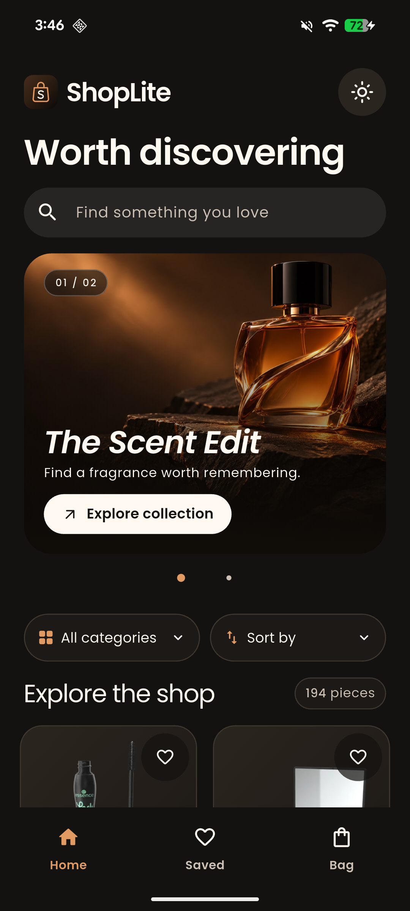
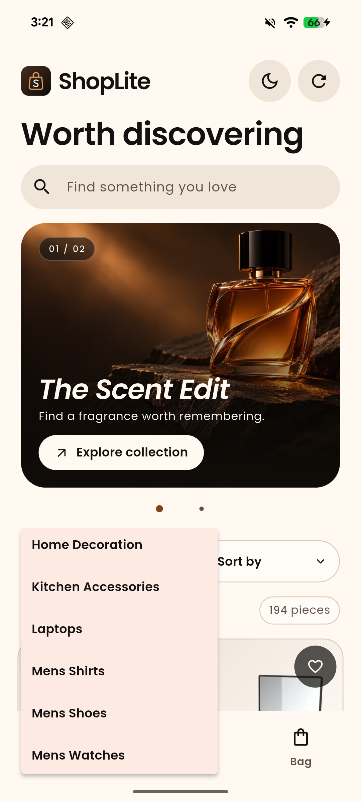
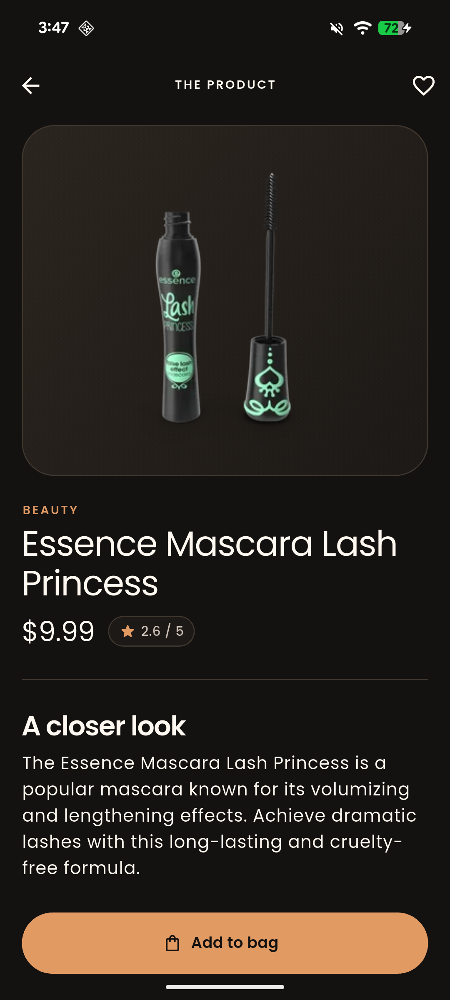
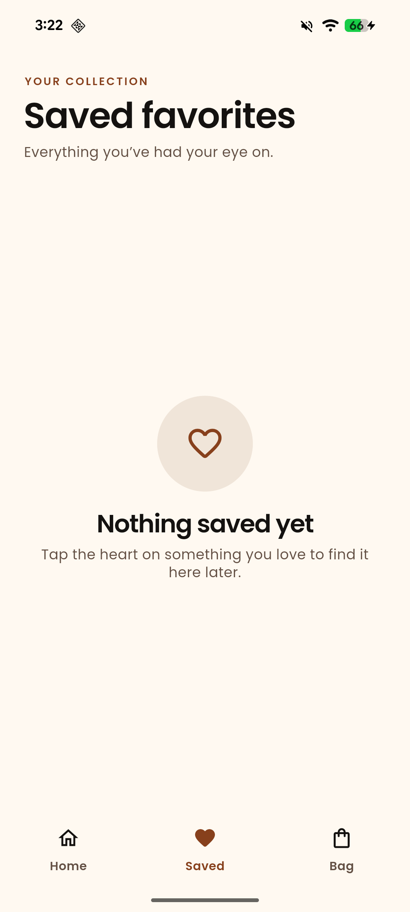
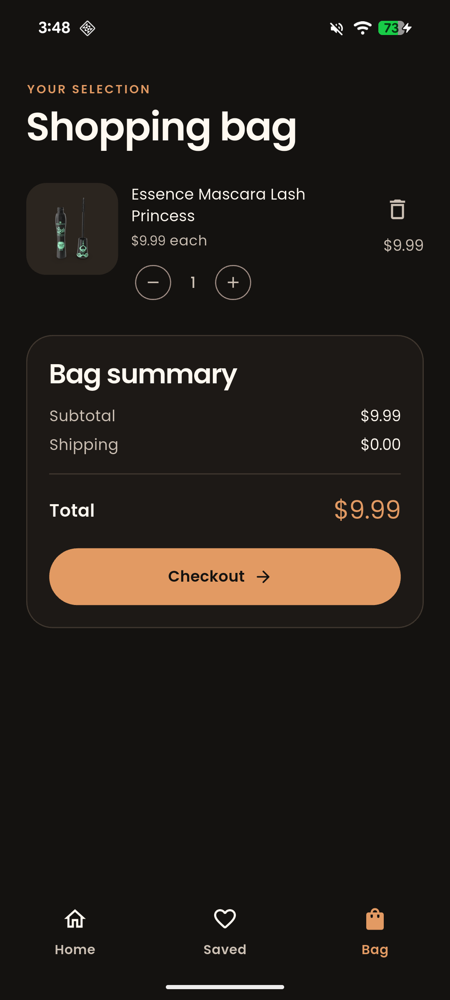

# ShopLite

ShopLite is a Flutter shopping application built for the supplied assessment. It lets users browse DummyJSON products, search, view details, add products to a cart, and save favorites.

On Home, open **All categories** and scroll the menu to choose a category. You can also sort by price or rating. These controls work with search. Select **Load more products** at the end of the grid for the next page. The sun and moon button switches between the cream and dark themes, and the app remembers the selection.

Add a product to the bag, then tap **Checkout**. Enter sample contact and delivery details and tap **Place demo order** to see a confirmation. The form runs locally, discards the details when you leave, and keeps the items in your bag.

## Run the app

1. Install a Flutter SDK that includes Dart 3.12.2 or later within the Dart 3 series, then run `flutter pub get`.
2. Start a mobile emulator or connect a device and run `flutter run`.
3. For Android, run `flutter build apk --release`. Install `build/app/outputs/flutter-apk/app-release.apk` with `adb install -r build/app/outputs/flutter-apk/app-release.apk`. The assessment build uses the local debug signing key.

The submission APK is a universal build for Android 7.0 (API 24) and later. The release APK was installed and launched on a Pixel 8.

## Packages and choices

- `provider` exposes a shared `ShopState` change notifier for catalog, cart, and favorites. Product details load independently of the catalog.
- `http` fetches the catalog, search results, and individual product details from DummyJSON.
- `shared_preferences` restores the cart, favorites, and theme preference at startup.
- Poppins is bundled for text and numbers. Its SIL Open Font License is in `assets/fonts/`.

## Architecture

```
lib/
  models/       Product and CartItem data objects
  services/     DummyJSON API and local persistence
  state/        Provider-based ShopState
  screens/      Home, detail, cart, demo checkout, and favorites screens
  theme/        Light and dark themes built around copper accents
  widgets/      Campaign carousel, catalog controls, product cards, and empty states
assets/         Bundled campaign photography
```

## API

- Product list: `GET https://dummyjson.com/products?limit=20`
- Product detail: `GET https://dummyjson.com/products/{id}`
- Search: `GET https://dummyjson.com/products/search?q={query}`
- Categories: `GET https://dummyjson.com/products/categories` and `GET https://dummyjson.com/products/category/{slug}`
- Catalog pages use `limit` and `skip`. Sorting uses `sortBy` and `order`.

## Tests

Run `flutter analyze` and `flutter test`. Unit tests cover cart operations, totals, and serialization. Widget tests cover category menu scrolling, combined search and filters, sorting, next-page retry, demo checkout, and theme persistence.

## Screenshots and demo

| Home | Categories | Details | Favorites | Cart |
| --- | --- | --- | --- | --- |
|  |  |  |  |  |

See the [demo checkout form](docs/screenshots/checkout.png) and the [demo confirmation](docs/screenshots/checkout-confirmation.png).

[Watch the simulator walkthrough](docs/shoplite-demo.mp4) for the earlier shopping flow. The walkthrough predates the Poppins and demo checkout updates. The category screenshot predates the latest font weight changes.

## Limitation

ShopLite simulates checkout. It does not place orders or collect payments. Browsing live product data requires an internet connection. The Home campaign photographs illustrate collections. Catalog listings and product details use DummyJSON product imagery.
